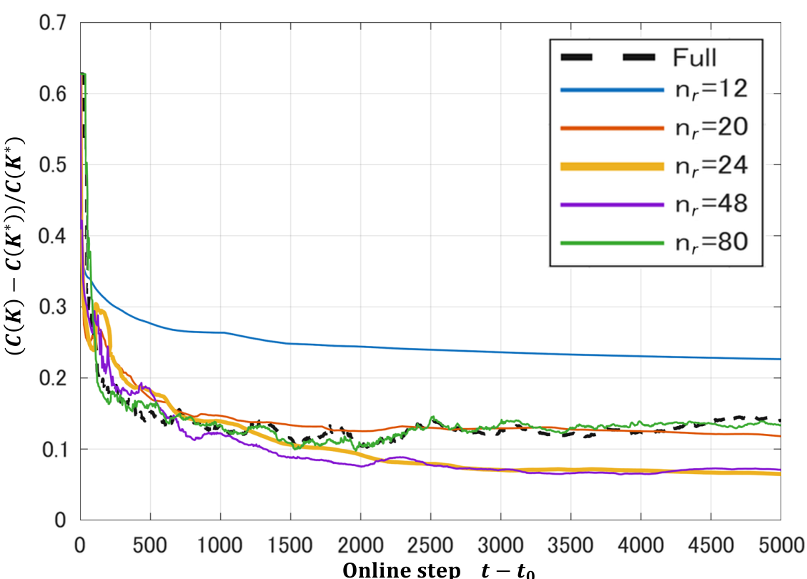
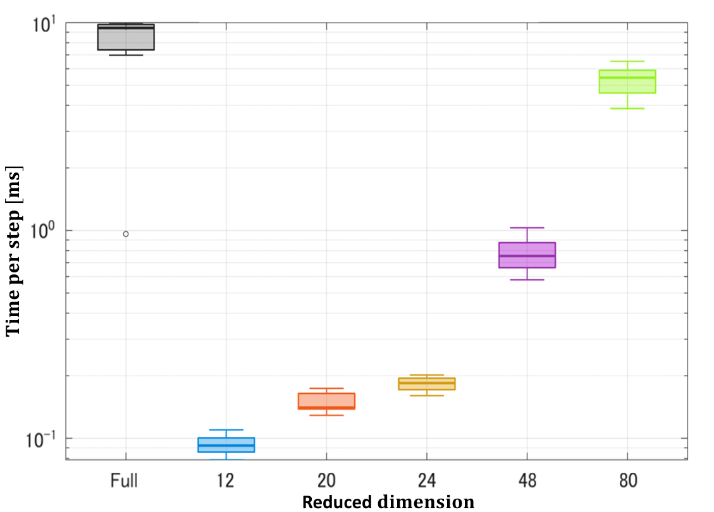

# 数値実験の結果

100状態・4入力の合成線形系で、全状態の間接型PGACと、SVDで縮約した間接型PGACを10試行で比較した。評価したのは、元の100次元系に対するLQR制御性能、オンライン計算時間、モデル推定に用いる回帰データの条件である。[実験設計](../docs/experiment-design.md)に指標の定義を記載した。

## 1. LQR制御性能

**図1. 最適性ギャップの推移。** 横軸はオンライン更新時刻 $`t-t_0`$、縦軸は真の100次元系の最適LQRコストに対する相対差である。24次元は、比較した縮約次元の中で良好な値に到達した。

## 2. オンライン計算時間

**図2. 制御器側の1ステップあたり計算時間。** モデル推定、勾配計算、Lyapunov方程式、ゲイン更新を対象とし、状態更新と真のモデルによるオフライン評価は計時から除いた。

## 3. Fullと24次元の比較

同一seedによる10試行では、**10組すべてで24次元の最終最適性ギャップがFullより小さかった**。平均値は0.17428から0.07310へ減少し、平均ギャップの低減率は58.1%となった。正確符号検定（両側）では $`p=0.001953125`$ であった。seed別の値は[比較表](tables/comparison.md)に掲載した。

| 指標 | Full（100次元） | Reduced（24次元） |
|---|---:|---:|
| 最終最適性ギャップ（10試行の中央値） | 0.1399 | **0.0648** |
| 最終最適性ギャップ（10試行の平均） | 0.17428 | **0.07310** |
| 制御器側オンライン計算時間 | 9.43 ms/step | **0.184 ms/step** |
| 回帰共分散行列の最小特異値 | $`1.28\times10^{-12}`$ | **$`1.59\times10^{-4}`$** |
| 回帰共分散行列の条件数 | $`3.98\times10^9`$ | **$`32.4`$** |

計算時間は約51分の1になった。最小特異値は大きくなり、条件数は小さくなった。これは今回の低次元回帰がFullより良好な数値条件を持ったことを示す。

## 4. なぜ24次元付近で良い結果になったか

実験用プラントは、12方向を大きく励起し、続く12方向を制御上重要にして、残り76方向の励起を弱めた構成である。SVDは初期データの主な変動を拾うため、24次元付近で重要な方向を保持しながら回帰の次元を減らせる。24次元を超えると弱励起方向が推定対象に増え、回帰の条件と計算負荷に影響する。

この3群構造とそのパラメータは、[実験方法](../docs/experiment-design.md#2-100次元合成プラントの構成)で説明した。今回の結果は、この構造を持つ合成システムに対して得たものである。

詳しい評価条件と数値は[比較表](tables/comparison.md)にまとめた。
